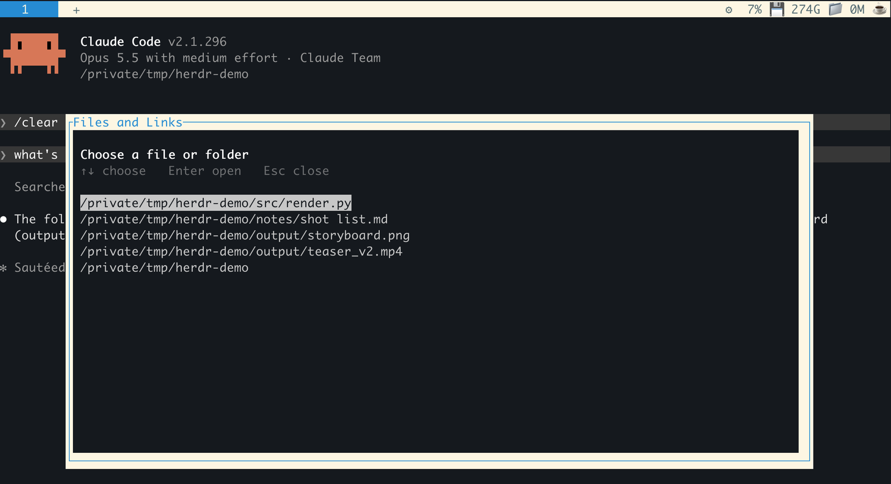
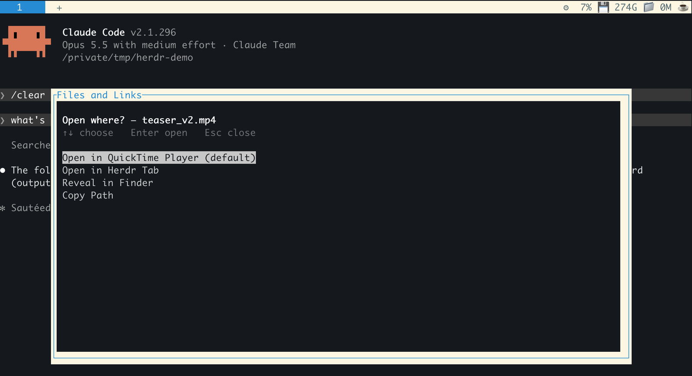
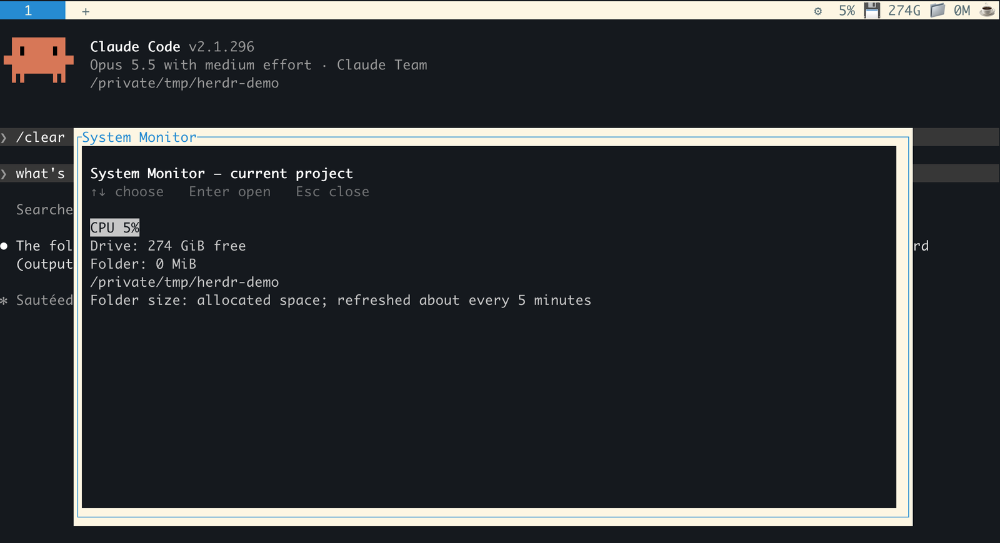
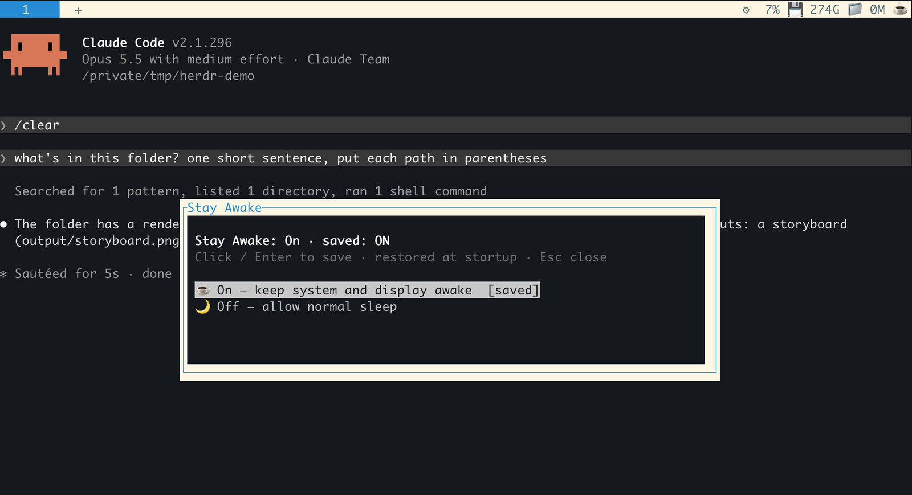
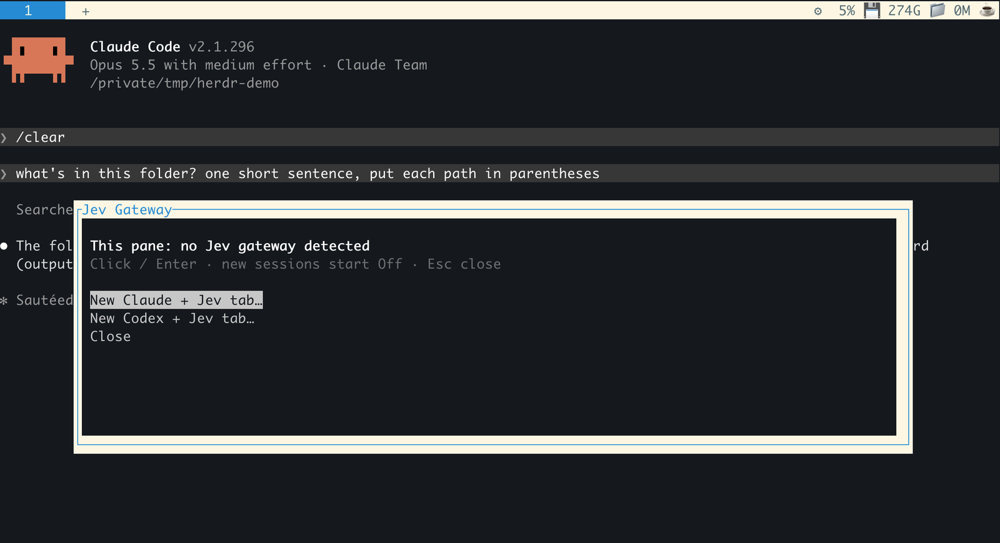
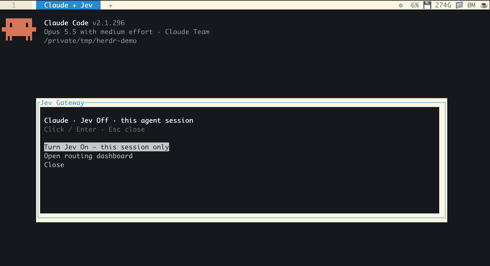

# Herdr macOS plugins

Four small plugins for [Herdr](https://herdr.dev) on macOS. Open files straight from agent output, keep the Mac awake while agents work, see CPU, disk and folder size in the tab bar, and switch Jev on or off per Claude or Codex session.

Works with standard Herdr 0.9.3, no custom build. MIT licensed.


## Files and Links

Press **Control+Option+O**. The plugin finds the files mentioned in the pane (or in what you selected) and asks which one to open.



One file goes straight to "Open where?". The default entry is the app macOS already uses for that file, so an MP4 opens in QuickTime (or whatever you set), same as `open` in the terminal. Folders open in Finder.



Paths can be relative, absolute, `file://` links, Markdown links, or have `:line:col` at the end. Spaces and Unicode are fine. A sentence with a few paths in parentheses offers all of them.

Herdr 0.9.3 clears the mouse selection before a plugin shortcut runs, so the plugin reads the clipboard once when you press the shortcut and only uses it if that text is on screen. With Herdr's default `copy_on_select = true` this just works. There is no clipboard watcher.

Limits: with nothing selected, the scan skips bare words with no extension or slash (`Makefile`, `.env`) so normal words don't turn into files. Select those paths and it works.

"Open in Herdr Tab" only shows up if you have Tode (files) or terminal-browser (links) installed. Neither is bundled. See [VERIFICATION.md](VERIFICATION.md) before using it.

## System Monitor

CPU, free space on the project's drive and the project folder size, in the tab bar. **Ctrl+B**, then **Shift+M** for details.



Folder size is allocated disk space, without following symlinks or crossing volumes. The scan runs at low priority, stops after 30 seconds and is cached for 5 minutes.

## Stay Awake

**Ctrl+B**, then **Shift+A**. On runs `caffeinate -di` for as long as the plugin's worker is alive, so idle sleep and display sleep are blocked. Closing the lid still sleeps the Mac. The choice is restored when Herdr starts.



Tab bar icon: ☕ on, 🌙 off, ⏳ changing, ❔ not confirmed. If the Herdr server goes away, awake is released. Short API stalls are tolerated for up to 15 minutes.

## Jev

[jev-gateway](https://github.com/vinilana/jev-gateway) is a local gateway that sends an agent's "which tool next" decisions to Jev, TypeSafe's fast decision model, and everything else to your usual model. **Ctrl+B**, then **Shift+J**.

In a pane without Jev, the menu opens a new tab named **Claude + Jev** or **Codex + Jev**. Each tab gets its own gateway and starts with Jev Off.



Inside a Jev tab, the same shortcut turns Jev on or off for that session only. It doesn't open another tab.



If the pane runs the official `jev-claude` or `jev-codex` launcher, the switch changes the shared gateway, so it asks first.

Needs Node.js 22.15+, a Jev key and the gateway:

```sh
npm install -g jev-gateway
jev-claude --setup
```

## Install

macOS, Herdr 0.9.3+ and Python 3.11+ for the installer. The plugins themselves also run on the macOS system Python 3.9.

```sh
git clone https://github.com/klinter007/herdr-macos-plugins.git
cd herdr-macos-plugins
python3 scripts/install.py
```

Keep the checkout, Herdr links to it. The installer registers the four plugins, adds one removable block of keys and one status block to `~/.config/herdr/config.toml`, and starts the monitor. Stay Awake starts Off.

It won't overwrite an existing custom status bar, a key that's already taken, or the same plugin linked from another folder. It keeps config symlinks and permissions, saves one `config.toml.herdr-tools.bak` the first time, and rolls back if a step fails.

After installing, pick **Menu → reload config** in each open Herdr client so the new keys load.

### Keyboard

The shortcut is lowercase **o**, no Shift. Option is Alt.

**iTerm2:** if the shortcut does nothing or goes to the agent, add a key mapping in Settings → Profiles → Keys → Key Mappings: Control+Option+o, Send Hex Code, `0x1b 0x0f` (zero, f). [iTerm docs](https://iterm2.com/documentation-preferences-profiles-keys.html).

**Terminal.app:** turn on Settings → Profiles → Keyboard → Use Option as Meta key. This changes all Option combos. I haven't tested the shortcut in Terminal.app. [Apple docs](https://support.apple.com/guide/terminal/trmlkbrd/mac).

Without any mapping, **Ctrl+B** then **Shift+O** opens the same file menu.

### Remove

```sh
python3 scripts/install.py --uninstall
```

Unlinks the plugins and removes the config blocks. Safe to run twice. Saved settings and the config backup stay. Plugin IDs are `gili.files`, `gili.awake`, `gili.metrics` and `gili.jev`.

## Develop

Python standard library and built-in macOS tools only (Jev also uses Node.js).

```sh
python3 -m unittest discover -s tests -q
```

Tests mock app launches and installer changes. When reporting a bug, include Herdr, macOS, Python and terminal versions. Never paste clipboard contents, keys, private paths or logs into an issue.
